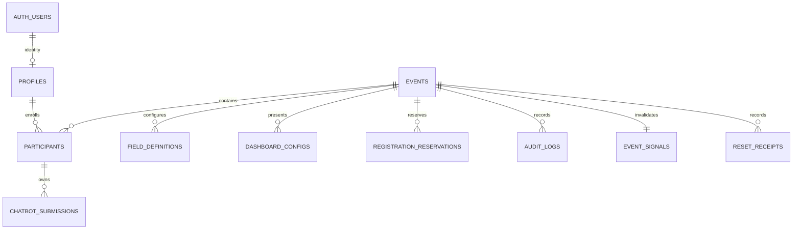
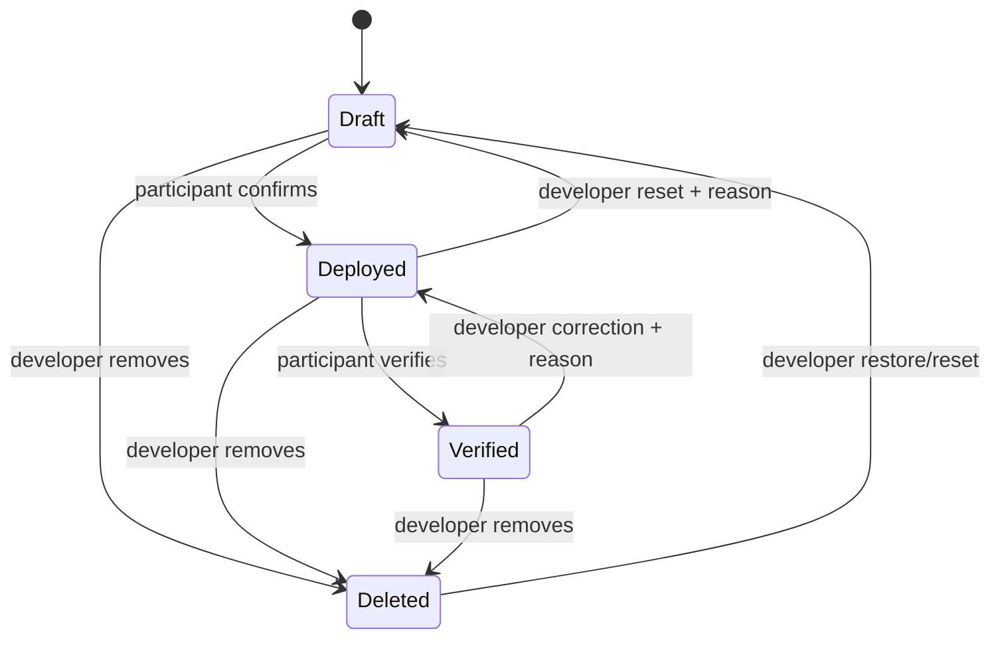
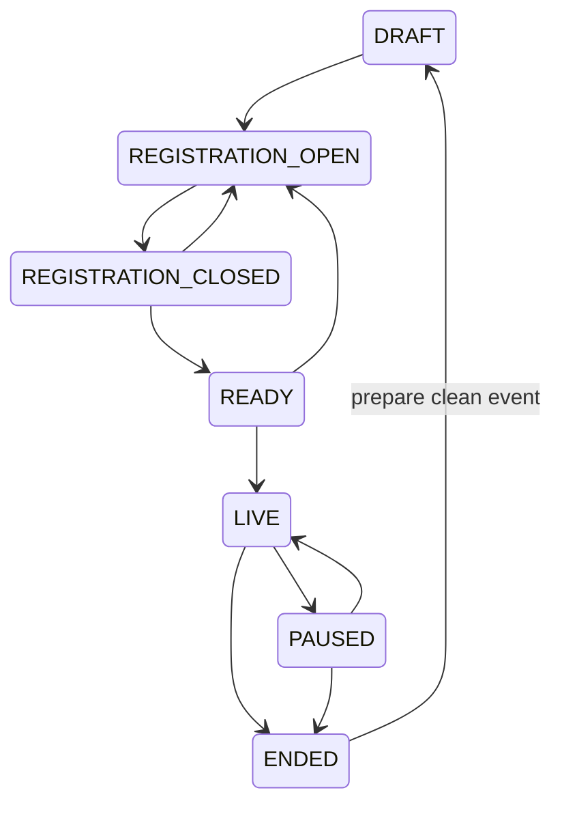

# RecordForge architecture — implementation contract

Status: reviewed before implementation. One primary event; no selectable test/final runs.

## 1. Runtime and boundaries

Native Next.js App Router + TypeScript + Tailwind on Node/Vercel. Supabase Auth owns passwords and sessions. PostgreSQL owns all event records and rules. Supabase Realtime invalidates query snapshots; it never carries trusted counter increments. Server routes use the caller's verified session for normal operations. A server-only service client is restricted to registration provisioning, login lookup, rate limiting and retired-account maintenance.

Username authentication maps a normalized username to an opaque internal Auth email. A registration reservation serializes register-number, username, Event ID and capacity checks before Auth account creation. Finalization and compensation make this cross-service process retryable; a stale reservation expires. No custom password hashing or password persistence. Direct public Auth signup is disabled in production. Orphan Auth users have no profile, role or application access; investigate expired reservations before removing unused identities through the provider.

## 2. ER diagram



## 3. Tables and constraints

| Table | Main columns and invariants |
|---|---|
| events | singleton UUID; generation; name; state; participant/chatbot limits; duration; start/pause/end; accumulated pause seconds; ID settings; version |
| profiles | Auth UUID PK; normalized username globally unique while active; participant/developer role; enabled; retired_at; no client writes |
| participants | UUID; event/generation; profile UUID; name/department/register number/Event ID; custom JSON; enabled/deleted_at; unique register number and Event ID per generation; one identity per generation |
| registration_reservations | idempotency UUID; event/generation; username/register/Event ID; validated registration payload; expiry; Auth UUID on completion; no passwords |
| chatbot_submissions | UUID; event/generation; participant FK; sequence; title/URL/custom data; official timestamps; version; soft delete; unique active sequence; verification requires deployment and verification >= deployment |
| field_definitions | event; scope registration/submission; safe key; label; type; enabled/required; display flags; protected names rejected |
| dashboard_configs | event + kind PK; strictly validated presentation JSON |
| audit_logs | immutable ID; generation; actor; role; action; entity; old/new JSON; reason; correlation ID; DB timestamp |
| event_signals | event PK + revision only; intentionally public; no personal data |
| reset_receipts | request UUID PK; operation; before/after generation; outcome; prevents retries resetting new data |
| rate_limits | hashed actor/IP and action; fixed time bucket with absolute expiry; never browser readable |

All tables have RLS. Public roles have no direct writes. All business mutations use explicitly granted SECURITY DEFINER functions with fixed search_path, auth.uid() checks and schema-qualified tables. Internal helpers are in private schema, not exposed by PostgREST. SQL grants are allowlisted after revoking default function execution.

The exact executable column definitions, foreign keys, partial unique indexes and checks live in ordered supabase/migrations files. Records in older generations cannot be read by participants or mutate the current event. Developers can export audit history across generations.

## 4. Permission matrix and RLS

| Capability | Anonymous | Participant | Developer |
|---|---|---|---|
| Public sanitized display snapshot | Yes | Yes | Yes |
| Own active profile/submissions | No | Read | Read all |
| Create/edit own draft | No | Event permits | Correction workflow |
| Deploy/verify normally | No | Own records only | No impersonation |
| Official correction | No | No | Reason + optimistic version required |
| Configuration/event controls | No | No | Yes |
| Logs/exports/reset | No | No | Yes |
| Assign developer role | No | No | Offline bootstrap only |

Public RPCs return allowlisted display properties, never private columns, Auth UUIDs or register numbers. Config controls disclosure server-side, not merely CSS visibility. Table-read policies for participants require current generation, active identity and ownership. A disabled profile cannot perform actions even with an unexpired JWT.

## 5. Chatbot state machine



State is derived from timestamps; there is no independently writable completed flag. Normal participant edits freeze after deployment. Correction accepts protected timestamps only from authenticated developers, validates ordering and records old/new states. Restore can preserve milestones when valid and capacity allows.

## 6. Event state machine and timer



Only LIVE permits participant submission mutations. Registration only in REGISTRATION_OPEN. Deadline = started_at + duration + completed pause intervals. While PAUSED, remaining time is measured at paused_at. Expiry blocks mutations regardless of whether the organizer has pressed End; snapshot presents ENDED after expiry. Resume cannot revive an expired competition. An explicit reset is required for a new event. Lock order is event, participant, chatbot; ordinary submission requests take a shared event row lock, while configuration/reset takes an exclusive event row lock. This lets different participants commit concurrently while preventing a reset/configuration race.

## 7. Registration flow

Validate body and configured fields → rate limit → reserve register number, username, Event ID and capacity under event lock → create Supabase Auth user with opaque internal address → finalize profile/participant under lock → commit audit → sign in. Duplicate submissions carry the same request ID; retry resolves the same reservation. Expired/failed reservations cannot consume capacity forever. If an Auth call commits but its response is lost, retry finds the user by reservation metadata/opaque address using the admin API. Identity collision fails clearly; ID configuration or a department correction resolves it before retry. Developer Event ID edits have uniqueness checks.

## 8. Completion transaction

Verified caller → shared event lock → active participant row lock → owned chatbot row lock → return existing state for an already committed milestone → otherwise validate LIVE/deadline and ordering → set database clock_timestamp() → append audit → invalidate event signal in same transaction → return authoritative row. Replays never change timestamps or add another completion audit. Create uses a caller-generated stable UUID persisted across retry, plus participant-level locking for limits and smallest free sequence. Destructive admin operations use request receipts.

All counts filter current generation, non-deleted participants/submissions and BOTH timestamps. Disabled participants retain legitimate existing evidence but cannot modify it. Soft-deleted participants and their submissions do not count. One canonical completed view feeds aggregates, leaderboard and diagnostics; separate direct SQL counts verify its consistency. No mutable completion counters exist.

## 9. Reset and recovery

PREPARE CLEAN EVENT requires typed phrase, displayed impact, final confirmation, current generation/version and stable request UUID. One DB transaction archives participants/submissions with soft deletion, retires participant profiles (revokes access and releases usernames), increments generation and resets timer/state. It preserves developer identities, all configuration and immutable audit history. Supabase Auth identities are retained disabled by application authorization for recoverability; a separately run maintenance script may ban retired Auth accounts through supported admin APIs. It does not delete evidence-linked identities. The UI clearly describes this. Old register numbers/Event IDs may register in the fresh generation. Repeating the reset request returns its receipt and cannot wipe new registrations.

Granular reset operations cover chatbot, participant submissions, all submissions, registrations, runtime and dashboard defaults. All resets are transactional, audited and require reasons/confirmation. No web-accessible audit purge or factory delete is provided. PostgreSQL point-in-time recovery/verified backups are required for irreversible infrastructure-level loss.

## 10. Audit/evidence strategy

Audit is append-only to application roles; old/new images omit secrets. Registration, creation, deployment, verification, corrections, configuration and lifecycle transitions are timestamped by PostgreSQL. Completion feed queries active completed records ordered by verified_at, while historical audit preserves revoked/reset milestones. CSV exports escape spreadsheet-formula injection and include the generation and UTC timestamps. DB owners remain able to alter database data: this system supplies evidence, not legal certification or cryptographic nonrepudiation.

## 11. Realtime/reconciliation

RLS-visible event_signals revision invalidates queries with a short throttle and coalesced requests. Clients fetch authoritative snapshots initially, after SUBSCRIBED/reconnect, on focus/online, after every mutation and on a jittered periodic fallback. Payloads never increase counters. Each snapshot includes DB server time, generation and version; stale in-flight responses cannot replace newer snapshots. Disconnect/error status is visible. Public snapshots are sanitized in DB and never cached with private sessions. Limit feed/log pages and use indexed queries.

## 12. Failure and recovery matrix

| Failure | Concrete behavior |
|---|---|
| Duplicate click/two tabs | row lock + idempotent timestamp transition |
| Commit but lost response | retain request ID; re-fetch state; repeat same action safely |
| Missed realtime event | reconnect/focus/periodic authoritative snapshot |
| Wrong device clock | DB time offset and server deadline checks |
| Configuration conflicts | exclusive event lock; reject limit below occupied sequences/capacity |
| Admin concurrent edits | expected version check, reject stale overwrite |
| Reset interrupted | transaction rolls back or receipt confirms success |
| Reset after lost response | receipt returned before any second destructive action |
| Accidental removal | soft-delete restore with capacity validation |
| Auth provisioning interrupted | reservation recovery/compensation; orphan has no access |

## 13. Directory structure

```
src/app/                  route pages, auth and command APIs
src/components/           participant, developer, display and shared UI
src/lib/                  typed contracts, validation, snapshots, errors
src/lib/supabase/          browser/server/admin clients
supabase/migrations/      reproducible tables, policies, RPCs, seeds
scripts/                  developer bootstrap, test fixtures, safe tooling
tests/                    unit, DB/RLS, concurrency, browser checks
docs/                     architecture, security, deployment, test results
EVENT_DAY.md              operational runbook
```

## 14. Contradiction review

- The later single-event instruction supersedes selectable test runs. Internal generations are a reset safety boundary, not separate interfaces/environments.
- Participant self-verification is the normal evidence source; developer overrides are visibly audited corrections, never silently attributed to a participant.
- Registration uniqueness is per active generation; old archived accounts cannot authenticate into the competition after reset.
- Supabase Auth has email/password APIs, so username is a server-resolved alias; internal email is not a participant-facing credential.
- Event expiration freezes actions even if realtime or a scheduler is unavailable.
- Production provider testing needs real Supabase/Vercel credentials. Local PostgreSQL tests prove DB invariants but cannot prove managed Auth/Realtime behavior or hosted throughput.

## 15. Official references checked

- https://nextjs.org/docs/app/getting-started/installation
- https://supabase.com/docs/guides/auth/server-side/nextjs
- https://supabase.com/docs/guides/database/postgres/row-level-security

Dependency versions are resolved from the npm registry and pinned by package-lock.json.
